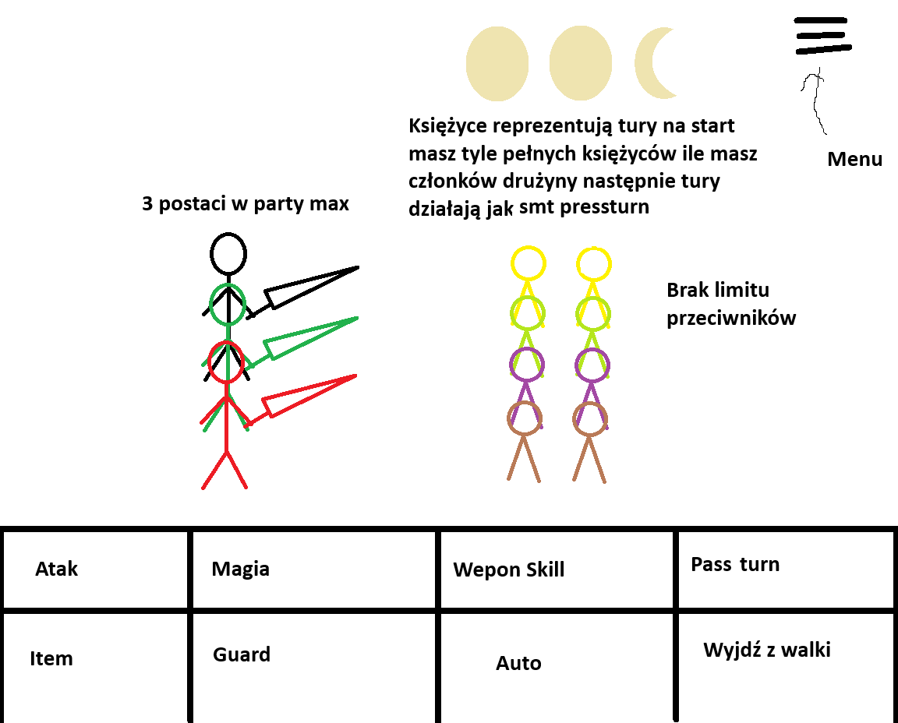

# Untilted Gacha Game

## Ogólny Koncept Gry

Mroczne, turowe RPG z mechaniką pseudo-gacha. Zbierasz hot anime demon dziewczyny.

---

## System Gacha: Sklep u Johna Szatnisty

### Główne założenia

* **Transakcja:** Płacisz Johnowi Szatniście gotówkę (walutę z gry).
* **Rytuał:** W zamian John rysuje na ekranie krąg przyzwania.
* **Piekielny Drop:** Z otwartego portalu dostajesz postaci i bronie.

### Poziomy Rzadkości (Tiers)

* **Lost Soul (Zagubiona Dusza):** Zwykłe (Trash/Fodder)
* **Demon:** Rzadkie (Rare)
* **Archdemon:** Epickie (Super Rare)
* **Devil:** Legendarne (Ultra Rare)

---

## Rozgrywka (Gameplay)

### Eksploracja Świata

Poruszasz się po mapie w stylu 2d Super Mario (widok z góry, chodzenie między punktami połączonymi drogami).

### System walki – Press Turn

> **Koncept UI:**
> 

#### 1. System ikon tur (Moon Icons)

* Na początku walki drużyna otrzymuje liczbę pełnych ikon księżyców równą liczbie członków aktywnej drużyny.
* Maksymalny rozmiar drużyny wynosi 3 postacie.
* 1 postać = 1 pełny księżyc.
* 2 postacie = 2 pełne księżyce.
* 3 postacie = 3 pełne księżyce.

* Każda postać może wykonać akcję podczas tury drużyny. Wykorzystanie akcji zużywa ikonę księżyca.

#### 2. Zasady Press Turn

System nagradza skuteczne wykorzystywanie słabości przeciwników i karze za nietrafione ataki.

* **Zwykły trafiony atak:** zużywa jeden pełny księżyc.
* **Trafienie w słabość przeciwnika:** zużywa połowę ikony księżyca zamiast całej, pozwalając drużynie wykonać dodatkowe akcje.
* **Trafienie krytyczne:** działa identycznie do trafienia w słabość.
* **Pominięcie ataku (Miss):** zużywa dodatkową ikonę, ponieważ postać traci możliwość efektywnego wykorzystania swojej tury.
* **Atak zablokowany, odporny lub pochłonięty (Null/Repel/Drain):** kończy turę drużyny.
* Jeżeli zostaje tylko jedna połowa księżyca, wszystko co zużywa pełny księżyc zużywa tylko tę połowę.
* Niektóre specjalne ataki mogą dodać lub odjąć więcej tur.
* Po wykorzystaniu wszystkich ikon ruch przechodzi na przeciwników.

#### 3. Typy ataków i żywioły

Walka wykorzystuje sześć typów żywiołów:

* Fire
* Ice
* Wind
* Telekinetic
* Soul
* Dark

Każdy przeciwnik i każda postać mogą posiadać określone słabości oraz odporności na poszczególne żywioły. Rozpoznawanie słabości przeciwników jest kluczowe dla efektywnego zarządzania ikonami Press Turn.

#### 4. Dostępne akcje w interfejsie walki

Interfejs walki zawiera osiem podstawowych opcji:

* **Atak (Attack):** Wykonuje podstawowy atak fizyczny broni.
* **Magia (Magic):** Używa zaklęć i ataków żywiołami, które posiada dana postać.
* **Weapon Skill:** Wykonuje specjalne umiejętności przypisane do broni.
* **Pass Turn:** Pomija akcję postaci i zużywa połowę ikony księżyca.
* **Item:** Używa przedmiotów, np. mikstur leczenia.
* **Guard:** Postać przyjmuje postawę obronną i zmniejsza otrzymywane obrażenia.
* **Auto:** Automatycznie wybiera akcje dla członków drużyny.
* **Wyjdź z walki:** Wraca gracza z powrotem na mapę.

#### 5. Przeciwnicy i kolejność tur

* Drużyna gracza może posiadać maksymalnie 3 aktywne postacie.
* Liczba przeciwników nie ma ustalonego limitu.
* Po zakończeniu puli ikon drużyny następuje tura przeciwników.
* Po zakończeniu tury przeciwników drużyna otrzymuje nową pulę pełnych ikon księżyców, zależną od liczby aktywnych członków drużyny.

### Summony

#### Summony:
##### Lost Soul(wszystko słabe na niskim dmg)[79%]:
sinner - dusza ze złamaną aureolą, obita i słaba. Dużo hp prawie nic ataku\
imp - mały demonek jak mały diabełek ale też słaby fire atak, mało hp\
poltergheis - telekinetic focus mało hp duży dmg, mało hp\
specter - słaby duch z negatywnych emoji. all round mage jedyny atak to drain(dark). daje buffy\
duchoid - duch stworzony z idei ludzi. ice lub wind\
duchoid - duch stworzony z idei ludzi. ice lub wind\
Banshee - duch który krzyczy i to jest wind atak\
topielec - ice ataki wodny theme\
##### Demon(troche lepsze niż lost soul)[15%]:
baku - demon wywołuje koszmary. soul i dark ataki\
incubus/sucubus - demon tank ale ma też ataki dark\
Wendigo - phys atak high speed\
oni - fire i dark\
drakula - all round mid jednostka z hp drain\
Azazel - high dps ale małe hp\
Abaddon - lepszy mage może dawać effekty na każdego przeciwnika\
Amon - high fire dps szybki i mid hp\
##### Archdemon[5%]:
belzebub - muchowy demon all round dużo hp tank
moloh - high dark and soul ataki mid hp
Leviathan - high physical/telekinetic dużo hp wolny
Lilith - najlepszy buffer w grze. elemental ataki
Mammon - ataki pieniędzmi. duże stunny i high speed
Belial - high elemental dps
Astaroth - używa sekretnej wiedzy itp żeby debuffować przeciwników najlepszy debuffer w grze

##### Devil[1%]:
Lucifer - all rounder special ataki z na każdego przeciwnika op ma atak ktory robi każdy element, hp draina itp
